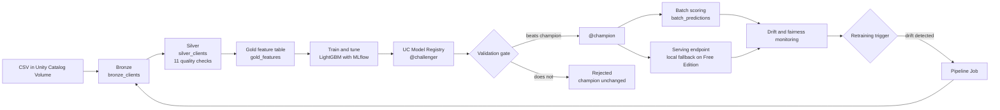

# Bank Credit Default MLOps on Databricks

An end-to-end MLOps project on Databricks that predicts whether a credit card client will default next month. It tackles data preparation, model development, deployment, automation, ML at scale and advanced monitoring, all governed in Unity Catalog.

**Stack:** Databricks (Unity Catalog, Delta Lake, MLflow, Lakeflow Jobs, Asset Bundles), PySpark, LightGBM, scikit-learn, SHAP

**Dataset:** [UCI "Default of Credit Card Clients"](https://archive.ics.uci.edu/dataset/350/default+of+credit+card+clients) (Taiwan, 2005): 30,000 clients, 23 input columns, binary target `default payment next month`.

---

## Business framing

A lender loses far more from a missed defaulter than from a wrongly flagged good client. This project assumes a **5:1 cost ratio** (a false negative costs 5, a false positive costs 1) and chooses the decision threshold that minimises that cost on a validation set, instead of using the default 0.5.

A useful sanity check: for well-calibrated probabilities the theoretical optimal threshold is `1 / (1 + 5) = 0.167`. The thresholds the pipeline found (0.16 and 0.17) match it.

## Architecture



## What was built

| Area | What was built | Databricks features |
|---|---|---|
| **1. Data preparation** | Raw CSV to Bronze, Silver and Gold Delta tables. Fixed undocumented `education` and `marriage` codes, 11 data quality rules that fail the run if broken, 9 engineered features, stratified 80/20 split | Unity Catalog (catalog, schema, volume), Delta Lake, medallion architecture, time travel, feature table with primary key |
| **2. Model development** | Logistic regression baseline, LightGBM with a 10-trial random search (nested runs), cost-based threshold, SHAP explainability | MLflow tracking and autologging, signatures, input examples, Unity Catalog Model Registry, aliases |
| **3. Deployment** | Batch scoring of all clients with an AUC reproducibility assertion, plus real-time serving code (endpoint with inference table, local `pyfunc` fallback) | `spark_udf`, Model Serving (local `pyfunc` fallback), inference tables |
| **4. MLOps** | Four-task pipeline with an automated validation gate, audit log and rollback alias | Lakeflow Jobs, task values, widgets, Asset Bundles (`databricks.yml`), Git folders |
| **5. ML at scale** | Data replicated to 3 million rows; single-node vs distributed benchmarks | Liquid clustering, `OPTIMIZE`, pandas UDFs, Spark ML, `mapInPandas`, `applyInPandas`, serverless compute |
| **6. Advanced MLOps** | Drift simulation with PSI and KS, performance tracking, retraining trigger, fairness audit, lineage | Delta audit tables, SQL alerts, Unity Catalog lineage, optional Lakehouse Monitoring |

**Deployment status**

- Real-time endpoint: `credit-default-endpoint` was **not created** in this Free Edition workspace (the endpoint list contains only Databricks-hosted foundation models), so `batch_and_serving` fell back to scoring the same JSON request payload locally with the registered `@champion` model. The endpoint creation code, including the inference table configuration, is included and is intended for workspaces where custom Model Serving is available. It has not been exercised here.
- Pipeline Job: deployed with `databricks bundle deploy -t dev` and run with `databricks bundle run`. All four tasks (`data_prep`, `train_model`, `validate_and_promote`, `batch_and_serving`) succeeded on serverless compute in about 4 minutes. `validate_and_promote` passes its decision and the champion version to downstream tasks as task values, and the weekly schedule is created paused. In this run the validation gate evaluated the newly trained version 3 (AUC 0.7826) against the champion (0.7910) and rejected it.

Design choices worth noting:

- `sex` and `age_band` are **excluded from the model inputs** and used only for the fairness audit. `age` remains an input.
- Models are loaded by **alias** (`@champion`), never by hard-coded version number.
- The decision threshold is stored as a **tag on the model version**, so batch scoring and serving always use the threshold that matches the model.
- The model is wrapped as a small `pyfunc` that returns the probability of default, which keeps batch and real-time outputs identical.

## Results

### Model performance (test set, 6,001 clients)

| Model | AUC | PR-AUC | KS |
|---|---|---|---|
| Logistic regression (baseline) | 0.7625 | 0.5266 | 0.4179 |
| **LightGBM, tuned (champion, version 2)** | **0.7910** | **0.5742** | **0.4444** |
| LightGBM, earlier run (version 1, seed 42) | 0.7826 | 0.5568 | 0.4288 |

### Business threshold

| Threshold | Expected cost (5 x missed defaulters + 1 x false alarms) |
|---|---|
| 0.50 (default) | 4,434 |
| **0.17 (cost-optimised)** | **3,260** (26.5% lower) |

At this threshold the model flags about 42% of clients. It catches 74.0% of real defaulters (recall) and 39.0% of flagged clients are genuine defaulters (precision), a deliberate trade-off under the 5:1 cost ratio. The test Brier score is 0.132, against about 0.172 for always predicting the 22.1% base default rate.

### Model promotion (validation gate)

| Run | Challenger AUC | Champion AUC | Decision |
|---|---|---|---|
| 1 | 0.7826 (v1) | 0.7826 (v1) | Skipped: challenger already champion |
| 2 | 0.7910 (v2) | 0.7826 (v1) | **Promoted**: version 1 kept as `@previous_champion` |
| 3 | 0.7826 (v3, from the pipeline Job) | 0.7910 (v2) | **Rejected**: champion unchanged |

### ML at scale (3 million rows, serverless compute)

| Experiment | Baseline | Scaled approach | Speedup |
|---|---|---|---|
| Batch scoring | 25.6s single-node | 13.4s pandas UDF | **1.9x** |
| Hyperparameter search (16 trials) | 44.8s sequential | 21.7s `mapInPandas` | **2.1x** |
| Selective query | 0.84s unclustered | 0.66s liquid clustering | 1.3x |
| Logistic regression training | 10.5s scikit-learn | 26.7s Spark ML | **0.4x (slower)** |
| 12 per-segment models | 68s summed model time | 19.1s wall time with `applyInPandas` | about 3.6x effective parallelism |

### Drift monitoring (simulated stress scenarios)

| Scenario | Features with PSI > 0.25 | Score PSI | AUC | Flagged rate | Retrain? |
|---|---|---|---|---|---|
| Stable (control) | 0 | 0.002 | 0.791 | 42.0% | No |
| Moderate | 1 | 0.056 | 0.781 | 52.6% | No |
| Severe | 10 | 0.476 | 0.678 | 69.7% | **Yes** |

The retraining rule fires if 3 or more features have PSI above 0.25, or the score PSI is above 0.25, or AUC drops by more than 0.03.

### Fairness audit (test set, at the business threshold)

| Attribute | Group | Clients | Approval rate | TPR | FPR | Disparate impact ratio |
|---|---|---|---|---|---|---|
| Sex | Female | 3,670 | 0.602 | 0.741 | 0.310 | 1.000 |
| Sex | Male | 2,331 | 0.547 | 0.740 | 0.359 | 0.908 |
| Age | 21-29 | 1,966 | 0.580 | 0.743 | 0.326 | 0.941 |
| Age | 30-39 | 2,278 | 0.617 | 0.723 | 0.299 | 1.000 |
| Age | 40-49 | 1,217 | 0.546 | 0.746 | 0.362 | 0.886 |
| Age | 50+ | 540 | 0.504 | 0.774 | 0.393 | 0.817 |

## Key findings

1. **Boosting beats the baseline clearly.** LightGBM improves AUC by about 0.03 over logistic regression and cuts expected cost by about 26% at the tuned threshold.
2. **Tuning did not overfit.** Validation and test performance agree (AUC 0.7915 vs 0.7910), even though the model and threshold were tuned on the validation set.
3. **The version 2 promotion is within noise.** Two training runs differing only in random seed gave AUC 0.7826 and 0.7910, and nearly identical expected cost (3,275 vs 3,260). A production gate should require a larger improvement or a significance test. The gate supports this through its `min_auc_improvement` parameter. Re-running the whole pipeline with seed 42 reproduced version 1's AUC exactly (0.7826), so training is deterministic for a given seed, and the gate correctly rejected the result.
4. **Distributing is not always faster.** Spark ML was 2.6x slower than scikit-learn for logistic regression on 2.4 million rows, because the data fits on one machine and Spark's overhead dominates. Scoring and hyperparameter search, which parallelise naturally, gained about 2x. All timings are single runs on small serverless compute, so treat them as indicative.
5. **Monitoring works without labels.** Under severe drift the score PSI and feature PSIs triggered retraining and flagged rates rose from 42% to 70%. Moderate drift was correctly tolerated by the rule, although the flagged rate still moved 11 points, which AUC alone would hide.
6. **PSI size is not importance.** `pay_5` and `pay_6` had the largest PSI (about 1.9) because they are concentrated on a few values, but a smaller shift in a stronger predictor such as `pay_1` matters more. Read drift alongside SHAP importance.
7. **No group breached the fairness review rule, but age 50+ is borderline.** Its disparate impact ratio is 0.817 against a 0.80 warning level, its false-positive rate is highest (0.393), and the group has only 540 clients, so the estimate is noisy.

## Limitations

- The data is a single historical dataset from Taiwan in 2005, so the model is a demonstration and not a deployable credit policy.
- Drift scenarios are **synthetic**. Labels were left unchanged, so the AUC drop reflects noisy inputs, not real concept drift.
- The scaled 3 million row dataset is synthetic (replicated with noise) and was used only for benchmarking.
- The 5:1 cost ratio is an assumption. A real lender would calibrate costs from loss data.
- The fairness audit covers two attributes with no causal analysis. `age` is a model input, and rules on using age in lending vary by country, so any real use needs legal review.
- No custom Model Serving endpoint existed in this Free Edition workspace, so real-time scoring was validated only through the local fallback. Lakehouse Monitoring was not attempted, and PSI and KS monitoring in a notebook is used instead.

## Screenshots

Screenshots of the lineage graph, model registry, MLflow experiment, pipeline run, drift results and fairness audit are in the [`screenshots/`](screenshots/) folder.

## Repository structure

```
Bank-credit-MLOps/
├── notebooks/
│   ├── data_prep.py                   # Bronze, Silver, Gold, quality checks, features, split
│   ├── train_model.py                 # baseline, LightGBM tuning, SHAP, registration
│   ├── batch_and_serving.py           # batch scoring and Model Serving endpoint
│   ├── validate_and_promote.py        # champion vs challenger gate, audit log
│   ├── scale_experiments.py           # single-node vs distributed benchmarks
│   └── monitoring_drift_fairness.py   # drift, retraining trigger, fairness audit
├── resources/
│   └── credit_pipeline.yml            # four-task Job definition
├── src/                               # reserved for shared helper code
├── screenshots/                       # screenshots of the Databricks workspace and results
├── databricks.yml                     # Asset Bundle
└── README.md
```

## Tables and models produced (`bank_mlops.credit`)

`bronze_clients`, `silver_clients`, `dq_results`, `gold_features`, `batch_predictions`, `promotion_log`, `scale_benchmarks`, `drift_metrics`, `monitoring_metrics`, `retraining_triggers`, `fairness_audit`, and the registered model `default_model` (aliases: `champion`, `challenger`, `previous_champion`).

## How to reproduce

1. **Get the data.** Download the Excel file from UCI and convert it to CSV (`pd.read_excel(..., header=1).to_csv(...)`). The `data/` folder is git-ignored.
2. **Create the catalog objects** in the Databricks SQL editor:
   ```sql
   CREATE CATALOG IF NOT EXISTS bank_mlops;
   CREATE SCHEMA  IF NOT EXISTS bank_mlops.credit;
   CREATE VOLUME  IF NOT EXISTS bank_mlops.credit.raw;
   ```
3. **Upload the CSV** with the Databricks CLI:
   ```bash
   databricks fs cp data/credit_default.csv dbfs:/Volumes/bank_mlops/credit/raw/credit_default.csv
   ```
4. **Link the repo** with a Databricks Git folder (Workspace, Create, Git folder).
5. **Run the notebooks** on serverless compute in this order: `data_prep`, `train_model`, `batch_and_serving`, `validate_and_promote`, `scale_experiments`, `monitoring_drift_fairness`. Or deploy the pipeline as a bundle:
   ```bash
   databricks bundle validate
   databricks bundle deploy -t dev
   databricks bundle run credit_default_pipeline -t dev
   ```


## Possible next steps
- Bootstrap confidence intervals for the fairness metrics, and retrain without `age` to compare.
- Replace the synthetic drift scenarios with a time-based split on real production data.
- Add a CI workflow (GitHub Actions) that validates the bundle on every pull request.
- Calibrate the cost matrix from real loss data and add probability calibration.
